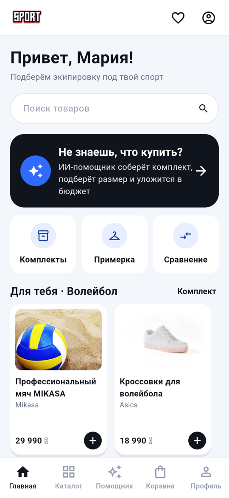
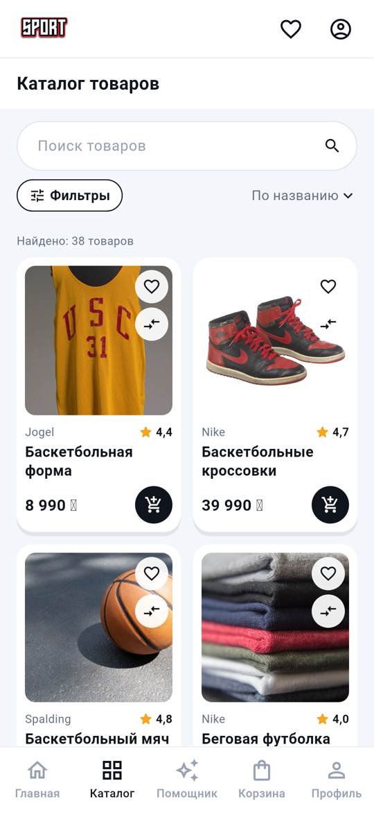
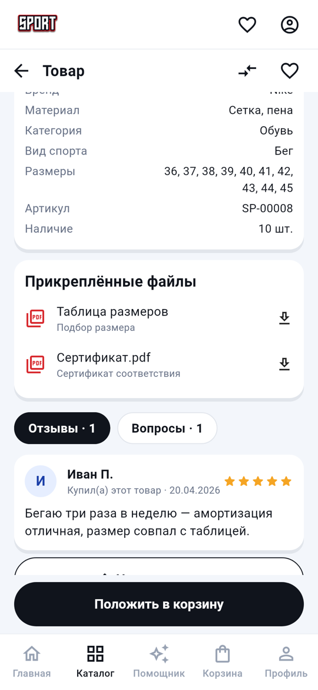

# SPORT — магазин спортивных товаров с ИИ-помощником и примеркой

Мобильное приложение на Flutter (курсовой проект → дипломный проект).
Автор: Габдулина Мария, группа ПО2401, колледж Astana IT University.

## Идея

Не просто магазин, а платформа подбора экипировки: пользователь указывает
вид спорта, уровень, параметры и бюджет, а приложение собирает комплект,
подсказывает размер, сравнивает товары и даёт примерить вещи на манекене.

## Возможности

| Раздел | Что умеет |
|---|---|
| Каталог | Поиск, фильтры, сортировка, сетка карточек с рейтингом, избранным и сравнением |
| ИИ-помощник | Чат: комплект под спорт / уровень / бюджет, поиск товаров, сравнение, размер. Отвечает карточками реальных товаров с объяснением выбора |
| Комплекты | Готовый набор для вида спорта и уровня; можно купить целиком или снять лишнее, размеры — из профиля |
| Умный размер | Рекомендация размера одежды, обуви, кимоно и перчаток по росту, весу и размерам профиля |
| Сравнение | До 4 товаров: цена, рейтинг, бренд, материал, размеры, «ваш размер», наличие + вывод |
| Избранное | Сохраняется в SQLite отдельно для каждого пользователя |
| Примерочная | По фотографии — нейросеть FASHN VTON на ноутбуке; живая — 3D-модель вещи в камере по позе тела |
| Отзывы и вопросы | Отзыв с оценкой — после получения заказа; рейтинг товара = средняя оценка. Вопросы задаёт любой покупатель, отвечает магазин |
| Профиль | Аватар из камеры или галереи, параметры, история заказов |
| Зал славы | Экспонаты КНУС и вещи спортсменов Казахстана: история, похожие товары, «Примерить похожее». Добавляет администратор |
| Администратор | Товары (добавить, изменить, фото, остаток, удалить), статусы заказов, ответы на вопросы |
| Покупка | Корзина в БД, оформление, история и детали заказов |

<p>
  
  
  
  
  
</p>

## Фото пользователя

Аватар и фото для примерки (лицо, фигура в полный рост) загружаются
добровольно, для примерки — после явного согласия. Файлы лежат в закрытой
папке приложения на устройстве (`MediaStorage`), никуда не отправляются
и удаляются по одному или все сразу на экране «Мои фото для примерки».

Фото товаров: файлы JPG в `assets/images/products/` (источники — в
[docs/image_credits.md](docs/image_credits.md), имена файлов — в
[docs/product_images.md](docs/product_images.md)) либо фото, которое
администратор прикрепил к товару из галереи.

## ИИ-помощник: три движка

`ConfigurableAssistantEngine` (lib/services/assistant) выбирает, кто отвечает:

1. **Gemini** — бесплатный тариф Google AI Studio. Ключ вводится прямо
   в приложении: чат → «Без нейросети · подключить». Получить ключ:
   aistudio.google.com/apikey (карта не нужна, есть лимит запросов).
2. **Claude** — если ключ задан при сборке
   (`--dart-define=ANTHROPIC_API_KEY=...`), платный.
3. **Локальные правила** — работают всегда и без сети; подхватывают
   диалог, если модель недоступна, ключ неверный или лимит исчерпан.

Модель получает каталог и профиль и возвращает структурированный ответ;
товары, которых нет в каталоге, отбрасываются.

> Ключ хранится на устройстве — этого достаточно для учебного проекта.
> В боевой версии ключ должен лежать на сервере.

## Примерочная

Открывается кнопкой «Примерить» в карточке товара. Два способа:

| | Примерка по фотографии | Живая примерка |
|---|---|---|
| Что делает | Нейросеть надевает вещь из каталога на фото пользователя | 3D-модель вещи следует за телом в камере |
| Технология | [FASHN VTON v1.5](https://github.com/fashn-AI/fashn-vton-1.5) (Apache-2.0) на ноутбуке | Google ML Kit Pose Detection + GLB-модели + собственный 3D-рендер |
| Где считается | Локальный сервер FastAPI на ноутбуке, по Wi-Fi | На телефоне, без интернета |
| Скорость | Минуты на одно фото (процессор) | В реальном времени |
| Платные сервисы | Нет | Нет |

Подробно — в [docs/try_on.md](docs/try_on.md): установка сервера на Windows,
подключение телефона, ограничения.

Примеряется одежда: футболки, форма, костюмы, шорты, штаны, купальник
(только по фото). Для обуви, защиты, инвентаря и аксессуаров приложение
объясняет, почему примерка недоступна.

## Стек

| Сейчас                         | Дальше (диплом)                   |
|--------------------------------|-----------------------------------|
| Flutter + Dart                 | Flutter + Dart                    |
| SQLite (sqflite) + каталог с сервера: FastAPI → PostgreSQL | Всё через сервер, телефон кэширует |
| ИИ: Gemini (бесплатно) / Claude / локальный | ИИ через свой сервер |
| Примерка: FASHN VTON на ноутбуке, 3D в камере | Сервер с видеокартой, HTTPS |
| Provider (ChangeNotifier)      | Provider / при необходимости иное |

## Архитектура

```
Screen → State (ChangeNotifier) → Service → Repository (abstract)
                                               ├── LocalXxxRepository → LocalDataSource → SQLite
                                               └── ApiXxxRepository   → REST API (backend/) → PostgreSQL
```

UI не знает, откуда пришли данные: при переходе на сервер
меняется только реализация репозитория.

## Структура

```
lib/
├── main.dart
├── core/          константы, тема, маршруты, утилиты
├── models/        модели данных (fromMap/toMap для SQLite, fromJson/toJson для API)
├── data/          база данных, источники данных, репозитории
├── services/      авторизация, рекомендации, комплекты, размер, ИИ-помощник
├── state/         состояния экранов (ChangeNotifier)
├── screens/       экраны по разделам
└── widgets/       переиспользуемые компоненты
```

## Сервер магазина (PostgreSQL)

Папка `backend/`. Установка PostgreSQL, запуск и подключение телефона —
[docs/postgresql.md](docs/postgresql.md).

## Запуск

```bash
flutter pub get
flutter analyze
flutter test
flutter run   # Android-эмулятор, устройство или Windows
```

## Ход работы

- [x] Этап 1 — структура проекта, тема, роутер
- [x] Этап 2 — модели
- [x] Этап 3 — SQLite и таблицы
- [x] Этап 4 — seed-данные
- [x] Этап 5 — Repository / DataSource, сервисы
- [x] Этап 6 — вход, регистрация, оболочка с нижней навигацией
- [x] Этап 7 — главная, каталог, фильтры, карточка товара
- [x] Этап 8 — профиль, редактирование профиля
- [x] Этап 9 — корзина (хранится в БД), оформление, «Заказ оформлен!», история, детали заказа
- [x] Этап 10 — AI-подбор: приветствие, опрос из 3 шагов, результат, «Что ещё купить?»
- [x] Этап 11 — единый визуальный стиль, русский интерфейс, новая главная и каталог
- [x] Этап 12 — ИИ-помощник (чат), комплекты, умный размер, сравнение, избранное
- [x] Этап 13 — примерочная на манекене (бета)
- [x] Этап 14 — примерка на своём фото, аватар, отзывы и вопросы, панель администратора
- [x] Этап 15 — бесплатный ИИ (Gemini), «Зал славы», фото вещей и автоподгонка в примерке
- [x] Этап 16 — AI-примерка по фото (FASHN VTON, локальный сервер) и живая 3D-примерка в камере
- [x] Этап 17 — PostgreSQL, шаг 1: сервер магазина (FastAPI + Alembic), каталог с сервера
- [ ] PostgreSQL, шаги 2–5: вход, корзина и заказы, отзывы, админка, остатки ([docs/postgresql.md](docs/postgresql.md))
- [ ] Уведомления о заказах, отслеживание доставки
- [ ] Миграции БД без потери данных (сейчас при смене версии база пересоздаётся)

## Демо-аккаунты

| Email | Пароль | Роль |
|---|---|---|
| maria@mail.kz | Maria123 | Покупатель (волейбол, стаж 6 лет) |
| ivan@mail.kz | Ivan1234 | Покупатель (бег, новичок) |
| admin@sport.kz | Admin123 | Администратор |

Список картинок товаров: [docs/product_images.md](docs/product_images.md).
